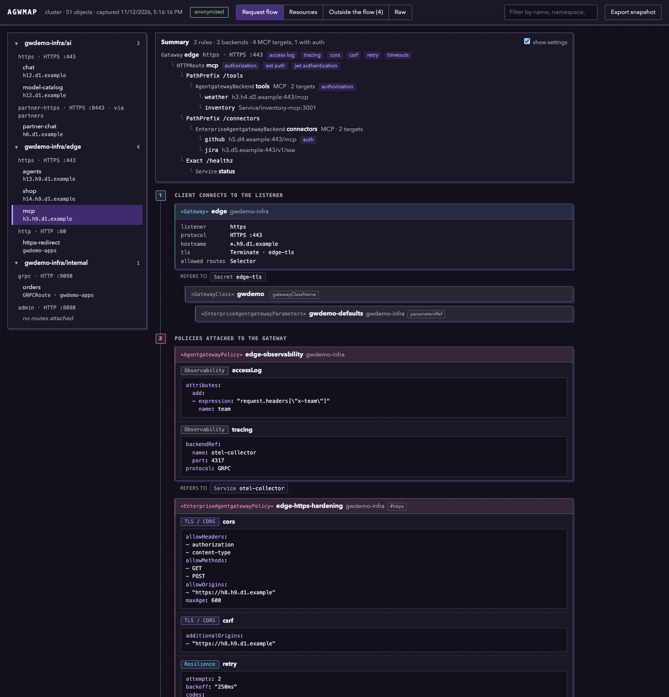

# agwmap

agwmap reads the gateway configuration of a Kubernetes cluster and turns it into one self-contained
HTML page that shows what happens to a request: which listener takes it, which policies apply at each
level, which route matches, and where it ends up.



## What it is for

The page is meant for a setup you did not build. Pick a route and read its path top to bottom:
listener, gateway policies, route, route policies, backends and their upstream targets. Policies are
labelled by what they do (authentication, rate limiting, guardrails, token exchange) and not only by
their kind.

Each route starts with a summary of that path in a few lines: the gateway, the route, its rules, the
backends and their targets, each with what is configured on it, and a count such as "1 rule · 1 backend
· 4 MCP targets, 3 with connector". Untick "show settings" to hide the YAML of each setting
and keep only what each object configures; the page remembers the choice, and clicking any object
shows its full YAML either way.

A backend target addressed to a gateway's own Service (`<gateway>.<namespace>.svc.cluster.local`)
sends the request back into that gateway. The map follows it to the listener on that port and the
route that takes its path, and draws that route under the target, or flags the target when nothing
there takes it. Clicking that route opens its flow, and the sidebar lists it under the route it is
reached from.

It also points at what is wrong or unused. Objects with a failing status condition are flagged, as are
cross-namespace references without a ReferenceGrant and settings configured at more than one level.
Whatever no request reaches, such as a dangling policy or an unused backend, is listed in its own tab.

On Solo Enterprise for agentgateway, the map shows the native plugins of each gateway: under its
parameters (and those of its class) the libraries they mount, with the OCI image or the Secret and
keys each comes from, and on the gateway and route policies each plugin instance they turn on, with
the library it runs, its order and the keys of its config. The cards never show the values of that
config, which can hold credentials, and an anonymized capture replaces them; with `-anonymize=false`
they stay in the object, as the Raw tab shows. It flags an instance whose library the gateway does
not mount, which fails its requests, and a mounted library that no policy turns on.

The output is anonymized by default so that you can send it to someone. Hostnames, URLs, IP addresses,
account and client ids and inline credentials are replaced with stable pseudonyms, and only gateway
labels and annotations are kept. Object names and namespaces stay, because the map is unreadable
without them, so read [what a capture keeps](#what-a-capture-keeps) before you send one. The Raw tab
shows exactly what a capture holds.

That works in the other direction too: to look at a cluster you have no access to, ask its owner to
run agwmap and send you the snapshot file, then render the same page from it.

agwmap is read-only. It discovers the gateway API groups and lists their objects. Secrets, ConfigMaps
and Services are never read; they appear only as names that something refers to.

It covers the Gateway API and agentgateway (open source and enterprise), including inference pools:
see [supported resources](#supported-resources). kgateway objects are read too, but that path has not
been tested yet.

## Install

As a kubectl plugin, with [krew](https://krew.sigs.k8s.io/):

```sh
kubectl krew install agwmap
```

If you installed it from the old `agwmap` custom index, which no longer gets new versions, switch to
the default index with `kubectl krew uninstall agwmap && kubectl krew install agwmap`, then remove
the old index with `kubectl krew index remove agwmap`.

Or download the archive for your platform from the
[releases](https://github.com/paurosello/agwmap/releases) and put `kubectl-agwmap` on your `PATH`.

Or with Go, which gives a binary named `agwmap`:

```sh
go install github.com/paurosello/agwmap@latest
```

## Use it

To try it without a gateway of your own, or without a cluster, render the
[demo manifest](testdata/demo.yaml) of this repository:

```sh
kubectl agwmap -from https://raw.githubusercontent.com/paurosello/agwmap/main/testdata/demo.yaml
```

Against a cluster, or a file:

```sh
kubectl agwmap                                  # current kube context, anonymized, opened in the browser
kubectl agwmap --context prod -n team-a -o a.html   # only the namespace you have access to
kubectl agwmap -open=false                      # only write the page and print where
kubectl agwmap -o snapshot.yaml                 # capture only, to send to someone
kubectl agwmap -from snapshot.yaml -o a.html    # render a capture you received
kubectl agwmap -from manifests.yaml             # render a manifest, without a cluster
kubectl agwmap -from deploy/                    # the same for every YAML file under a folder
kubectl agwmap -from https://example.com/gw.yaml  # the same for a file at a URL
kubectl agwmap -anonymize=false                 # keep the real values
```

The binary works the same under any name, for example `agwmap -o a.html`.

| Flag | What it does |
|---|---|
| `--context`, `--kubeconfig` | Which cluster to read. Default: the current context. |
| `-n`, `--namespace` | Read one namespace: see [one namespace](#one-namespace). Default: all namespaces (`-A` is accepted too). Cluster-scoped objects are always read. |
| `-o` | Output file. Default: a new `agwmap-*.html` in the temp folder, readable only by you. `-` writes the page to stdout. A name ending in `.yaml` writes a snapshot instead of the page. |
| `-open=false` | Do not open the page in the default browser. It is opened only when stderr is a terminal, so pipelines and CI jobs never open one. |
| `-from` | Render a YAML file instead of reading a cluster: a snapshot, or any manifest of gateway objects. Takes a local file, a folder or a URL. |
| `-anonymize=false` | Keep the real values. Without it the output is anonymized, also when `-from` is given a manifest or a snapshot that was not. |
| `-version` | Print the version. |

When a newer release exists, a released build says so in one line on stderr after writing the map,
with the command to update (`kubectl krew upgrade agwmap`). The check is one request to github.com
that sends nothing about the cluster; without network access it is skipped silently, and it is not made
when stderr is not a terminal.

agwmap needs permission to list the objects of the gateway API groups. A kind it may not list is left
out and named in a warning at the top of the page.

### One namespace

`-n` is for someone who may only read their own namespace, under a gateway that another team runs:
`kubectl agwmap -n team-a`. Without it agwmap reads all namespaces, and says to use `-n` when it
is allowed none of that.

The page then shows the request flow as far as that namespace knows it:

| In the namespace | Not on the page |
|---|---|
| Your routes, their rules, backends and the policies attached to them | The gateway, when it is in another namespace: its listeners, its class, and the policies attached to it, which apply to your routes too |
| Your ListenerSet: its listeners in full, and whether the gateway accepted it | Other routes on the same listener or hostname, and a route in another namespace that delegates to yours |
| What the gateway's controller reports on each route (`Accepted`, `ResolvedRefs`), per parent | A ReferenceGrant in the namespace of a backend you refer to, and the backend itself |

A gateway that was not read still starts the flow: it is drawn from what your objects say about it.
A route that goes through your ListenerSet shows that listener; a route attached straight to the
gateway shows the listener it names, and what the controller reports for it. Nothing that is merely
out of sight is flagged as wrong: a backend in another namespace reads "ReferenceGrant not visible",
not "no ReferenceGrant". A route without a parent is listed under "No parent in this namespace".

Cluster-scoped kinds such as GatewayClass are still asked for, so expect a warning for each one you
may not list.

A snapshot is a multi-document YAML manifest: one document of kind `agwmap-snapshot` that says where
and when it was captured, whether it is anonymized and what could not be read, then one document per
object. The page's "Export snapshot" button downloads the same file.

`-from` reads any other manifest the same way: the files you would give to `kubectl apply -f`, the
output of `helm template`, or the list that `kubectl get -o yaml` prints. It keeps the objects of the
gateway API groups and skips everything else, so a Secret in the file is not read. Nothing checks a
file the way an API server does: a misspelled field is not reported and defaults are not filled in.

Given a folder, `-from` reads every `.yaml` and `.yml` file under it, subfolders included (not the
hidden ones, such as `.git`), as one manifest. The files are read as they are: nothing runs
`kustomize build` or `helm template`. A file that is not valid YAML, such as a Helm template, is
skipped and named in the warning at the top of the page. When the same object is defined in more than
one file, as in a base and its overlay, the first one in path order is kept and the others are named
in that warning. To render a folder of a Git repository, clone it and point `-from` at the folder.

`-from` also takes the URL of a file, which is downloaded with one GET request and read the same way.
The URL must return the YAML itself: for a file on GitHub or GitLab that is the "Raw" link, not the
page that shows the file. Only the URL without its query string is printed or kept, because the raw
link to a file in a private repository can carry a token. A file larger than 32 MiB is refused.

## Supported resources

agwmap reads every kind served under the gateway API groups, so nothing has to be listed for it to be
captured: a kind it has no rule for still appears in the Resources and Raw tabs, attached where it
points if it has `targetRefs`, and otherwise under "Outside the flow". The kinds below are the ones the
map knows how to draw.

### Gateway API

Checked against Gateway API v1.7.0, standard and experimental channels. Older served versions of a
kind (`v1beta1`, `v1alpha2`, `v1alpha3`) are read the same way.

| Kind | Group | In the map |
|---|---|---|
| GatewayClass | `gateway.networking.k8s.io` | Under the gateway that uses it, with its parameters and the policies attached to it |
| Gateway | `gateway.networking.k8s.io` | Start of a flow, one per listener: protocol, port, hostname, TLS with its certificates and options, the client certificate validation and the certificate presented to backends that the gateway sets (`spec.tls`), the listener's status |
| ListenerSet | `gateway.networking.k8s.io` | Adds its listeners to the parent gateway; flagged when the gateway's `allowedListeners` does not admit it |
| XListenerSet | `gateway.networking.x-k8s.io` | The same (Gateway API v1.3 and v1.4) |
| HTTPRoute | `gateway.networking.k8s.io` | Route: hostnames, per rule the matches, filters, timeouts, retry and backends with weight and port |
| GRPCRoute | `gateway.networking.k8s.io` | Route, with gRPC service and method matches |
| TLSRoute | `gateway.networking.k8s.io` | Route on a TLS listener, with its SNI hostnames |
| TCPRoute | `gateway.networking.k8s.io` | Route on a TCP listener |
| UDPRoute | `gateway.networking.k8s.io` | Route on a UDP listener |
| ReferenceGrant | `gateway.networking.k8s.io` | Checked for every route backend and listener certificate in another namespace; a missing one is flagged |
| BackendTLSPolicy | `gateway.networking.k8s.io` | Policy on the backend it targets |
| XBackendTrafficPolicy | `gateway.networking.x-k8s.io` | Policy on the backend it targets |
| XTelemetryPolicy | `gateway.networking.x-k8s.io` | Policy on the gateway or route it targets |
| XBackend | `gateway.networking.x-k8s.io` | Backend, with its hostname or pod selector |
| XMesh | `gateway.networking.x-k8s.io` | Listed under "Outside the flow": it is not on a request path |

A route attaches to a listener by section name, port, protocol, `allowedRoutes` and hostname. A route
with `useDefaultGateways` attaches to every gateway whose `defaultScope` is the same, which is marked
"default gateway", and is then checked the same way. Routes can also be attached to a Service (mesh)
or to another route (delegation).

### Inference extension

| Kind | Group | In the map |
|---|---|---|
| InferencePool | `inference.networking.k8s.io`, `inference.networking.x-k8s.io` | Backend: pod selector, target ports and endpoint picker |
| InferencePoolImport | `inference.networking.x-k8s.io` | Backend, by name only (it has no spec) |
| InferenceObjective | `inference.networking.x-k8s.io` | Under the pool it refers to |

### agentgateway

Checked against Solo Enterprise for agentgateway v2026.11.1-patch.0.

| Kind | Group | In the map |
|---|---|---|
| AgentgatewayPolicy | `agentgateway.dev` | Policy on the gateway, listener, route or backend it targets, each setting labelled by what it does, with its phase and inheritance (`strategy.inheritance`) as badges |
| AgentgatewayBackend | `agentgateway.dev` | Backend, with its upstream targets: LLM providers, MCP servers, A2A, static hosts, AWS. An MCP target with a condition is marked conditional |
| AgentgatewayModel | `agentgateway.dev` | Backend of the route it names, with the model it matches |
| AgentgatewayParameters | `agentgateway.dev` | Under the gateway or class that uses it |
| EnterpriseAgentgatewayPolicy | `enterpriseagentgateway.solo.io` | As AgentgatewayPolicy, with the enterprise settings. A native plugin it turns on (`traffic.entPlugin`, also `conditional`) shows its instance name, library, order and config keys, and is flagged when the gateway does not mount its library |
| EnterpriseAgentgatewayBackend | `enterpriseagentgateway.solo.io` | As AgentgatewayBackend |
| EnterpriseAgentgatewayParameters | `enterpriseagentgateway.solo.io` | Under the gateway or class that uses it, with the native plugins it mounts (`spec.plugins`: image or Secret); a plugin that no policy turns on for the gateway is flagged |
| EnterpriseAgentgatewayBudget | `enterpriseagentgateway.solo.io` | Under the policy that enforces it |
| EnterpriseAgentgatewayExternalSecret | `enterpriseagentgateway.solo.io` | Under the object that refers to it |
| EnterpriseAgentgatewayRBACPolicy, EnterpriseAgentgatewayRoleBinding | `enterpriseagentgateway.solo.io` | Listed under "Outside the flow": access to the management UI, not to traffic |
| EnterpriseListenerSet | `enterprise.solo.io` | Adds its listeners to the parent gateway |
| AuthConfig | `extauth.solo.io` | Under the policy that refers to it |
| RateLimitConfig | `ratelimit.solo.io` | Under the policy that refers to it |
| WAFPolicy | `waf.solo.io` | Under the policy that refers to it |

## What a capture keeps

Of each object: `apiVersion`, `kind`, its name and namespace, `spec`, and `status` without timestamps.
The rest of `metadata` is dropped.

With anonymization, which is the default:

| Replaced with a pseudonym, or removed | Kept |
|---|---|
| Hostnames, wherever they appear, and IPv4 and IPv6 addresses | Names and namespaces of the objects |
| URLs: the host, path segments other than well-known words such as `/v1` or `/oauth2`, the query string | Names of what they refer to: Secrets, Services, models |
| E-mail addresses, GUIDs, AWS account ids and ARN resource names, Google Cloud project ids, client and tenant ids | Label and annotation keys under the gateway domains, and the labels a policy selects its targets by |
| Inline credentials: secret-like fields and headers, bearer and basic tokens, JWTs, API keys, PEM blocks | Free text: descriptions, CEL expressions, header names, paths in route matches |
| Every value of the config of a native plugin (`entPlugin.config`): only its keys are kept | Plugin names, and the path and tag of a plugin image (its registry is a hostname) |
| Labels and annotations outside the gateway domains listed in [`minimize.go`](minimize.go) | Model names, regions, ports, protocols |
| The kube context name or the name of the folder `-from` read, and the user and server named in warnings | The paths, inside a folder that `-from` read, of the files named in its warnings |
| | In-cluster hostnames (`name.namespace.svc`) of a captured Gateway's proxy Service or of a Service an object refers to, so that a target that goes back through a gateway can be followed |

Anonymization works by recognising values, so it can miss one it has no rule for, and it does not try
to hide what your objects are called. If a name gives away more than you want to share, or you find a
value that should have been replaced, look at the Raw tab before sending the file, and please
[open an issue](https://github.com/paurosello/agwmap/issues) (without the value). The rules are at the
top of [`anonymize.go`](anonymize.go).

With `-anonymize=false` nothing is replaced and all labels and annotations are kept.

## Limits

- Kubernetes objects only: a standalone agentgateway config file is not read.
- One cluster per page.
- A page of [one namespace](#one-namespace) cannot show what a gateway or a policy in another
  namespace does to its requests.
- When the same setting is configured at several levels, the page shows all of them but does not work
  out which one takes effect.

## Development

```sh
go test ./...      # builds the binary and runs it against a fake API server that serves testdata/
scripts/e2e.sh     # the same against a real kube-apiserver with testdata/demo.yaml (needs kwokctl, helm, jq, yq)
```

## Keeping up with the CRDs

[`crds.lock.json`](crds.lock.json) records the versions and fingerprints of the CRDs the map was last
checked against. A [daily workflow](.github/workflows/crd-watch.yml) compares them with the latest
Gateway API release and the latest Solo Enterprise for agentgateway CRD chart, and opens an issue
labelled `crd-drift` when a CRD was added, removed or changed. `scripts/crds.sh diff` shows what
changed, and `scripts/crds.sh update` records the new baseline once the map handles it; committing the
updated lock file is what stops the issue from being raised again.

## License

[Apache-2.0](LICENSE)
