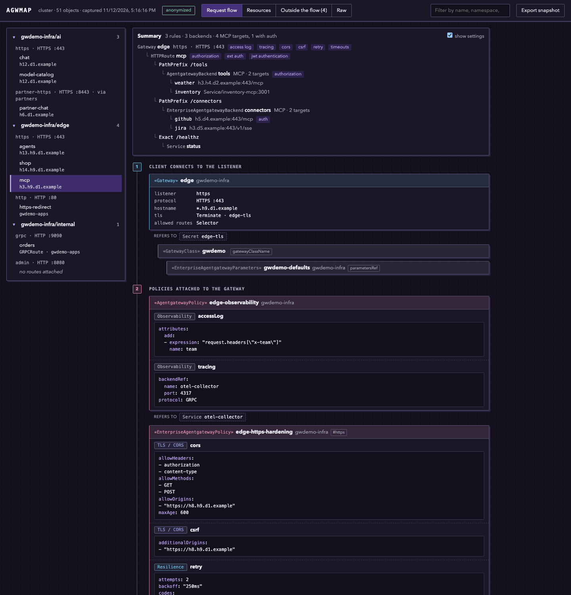

# agwmap

agwmap reads the gateway configuration of a Kubernetes cluster and turns it into one self-contained
HTML page that shows what happens to a request: which listener takes it, which policies apply at each
level, which route matches, and where it ends up.



## What it is for

The page is meant for a setup you did not build. Pick a route and read its path top to bottom:
listener, gateway policies, route, route policies, backends and their upstream targets. Policies are
labelled by what they do (authentication, rate limiting, guardrails, token exchange) and not only by
their kind.

It also points at what is wrong or unused. Objects with a failing status condition are flagged, as are
cross-namespace references without a ReferenceGrant and settings configured at more than one level.
Whatever no request reaches, such as a dangling policy or an unused backend, is listed in its own tab.

The output is anonymized by default so that you can send it to someone. Hostnames, URLs, IP addresses,
account and client ids and inline credentials are replaced with stable pseudonyms, and only gateway
labels and annotations are kept. Object names and namespaces stay, because the map is unreadable
without them, so read [what a capture keeps](#what-a-capture-keeps) before you send one. The Raw tab
shows exactly what a capture holds.

That works in the other direction too: to look at a cluster you have no access to, ask its owner to
run agwmap and send you the snapshot file, then render the same page from it.

agwmap is read-only. It discovers the gateway API groups and lists their objects. Secrets, ConfigMaps
and Services are never read; they appear only as names that something refers to.

It covers the Gateway API and agentgateway (open source and enterprise), including inference pools:
see [supported resources](#supported-resources). kgateway objects are read too, but that path has not
been tested yet.

## Install

As a kubectl plugin, with [krew](https://krew.sigs.k8s.io/):

```sh
kubectl krew index add agwmap https://github.com/paurosello/agwmap.git
kubectl krew install agwmap/agwmap
```

Or download the archive for your platform from the
[releases](https://github.com/paurosello/agwmap/releases) and put `kubectl-agwmap` on your `PATH`.

Or with Go, which gives a binary named `agwmap`:

```sh
go install github.com/paurosello/agwmap@latest
```

## Use it

```sh
kubectl agwmap                                  # current kube context -> agwmap.html, anonymized
kubectl agwmap --context prod -n team-a -o a.html
kubectl agwmap -o snapshot.json                 # capture only, to send to someone
kubectl agwmap -from snapshot.json -o a.html    # render a capture you received
kubectl agwmap -anonymize=false                 # keep the real values
```

The binary works the same under any name, for example `agwmap -o a.html`.

| Flag | What it does |
|---|---|
| `--context`, `--kubeconfig` | Which cluster to read. Default: the current context. |
| `-n`, `--namespace` | Read one namespace. Default: all namespaces (`-A` is accepted too). Cluster-scoped objects are always read. |
| `-o` | Output file, `agwmap.html` by default; `-` writes the page to stdout. A name ending in `.json` writes a snapshot instead of the page. |
| `-from` | Render a snapshot file instead of reading a cluster. |
| `-anonymize=false` | Keep the real values. Without it the output is anonymized, also when `-from` is given a snapshot that was not. |
| `-version` | Print the version. |

When a newer release exists, a released build says so in one line on stderr after writing the map,
with the command to update (`kubectl krew upgrade agwmap`). The check is one request to github.com
that sends nothing about the cluster; without network access it is skipped silently, and it is not made
when stderr is not a terminal.

agwmap needs permission to list the objects of the gateway API groups. A kind it may not list is left
out and named in a warning at the top of the page.

To try it without a gateway of your own, apply [`examples/demo.yaml`](examples/demo.yaml) to a cluster
that has the Gateway API and agentgateway CRDs.

## Supported resources

agwmap reads every kind served under the gateway API groups, so nothing has to be listed for it to be
captured: a kind it has no rule for still appears in the Resources and Raw tabs, attached where it
points if it has `targetRefs`, and otherwise under "Outside the flow". The kinds below are the ones the
map knows how to draw.

### Gateway API

Checked against Gateway API v1.7.0, standard and experimental channels. Older served versions of a
kind (`v1beta1`, `v1alpha2`, `v1alpha3`) are read the same way.

| Kind | Group | In the map |
|---|---|---|
| GatewayClass | `gateway.networking.k8s.io` | Under the gateway that uses it, with its parameters and the policies attached to it |
| Gateway | `gateway.networking.k8s.io` | Start of a flow, one per listener: protocol, port, hostname, TLS, certificates, the listener's status |
| ListenerSet | `gateway.networking.k8s.io` | Adds its listeners to the parent gateway; flagged when the gateway's `allowedListeners` does not admit it |
| XListenerSet | `gateway.networking.x-k8s.io` | The same (Gateway API v1.3 and v1.4) |
| HTTPRoute | `gateway.networking.k8s.io` | Route: hostnames, per rule the matches, filters, timeouts, retry and backends with weight and port |
| GRPCRoute | `gateway.networking.k8s.io` | Route, with gRPC service and method matches |
| TLSRoute | `gateway.networking.k8s.io` | Route on a TLS listener, with its SNI hostnames |
| TCPRoute | `gateway.networking.k8s.io` | Route on a TCP listener |
| UDPRoute | `gateway.networking.k8s.io` | Route on a UDP listener |
| ReferenceGrant | `gateway.networking.k8s.io` | Checked for every route backend and listener certificate in another namespace; a missing one is flagged |
| BackendTLSPolicy | `gateway.networking.k8s.io` | Policy on the backend it targets |
| XBackendTrafficPolicy | `gateway.networking.x-k8s.io` | Policy on the backend it targets |
| XTelemetryPolicy | `gateway.networking.x-k8s.io` | Policy on the gateway or route it targets |
| XBackend | `gateway.networking.x-k8s.io` | Backend, with its hostname or pod selector |
| XMesh | `gateway.networking.x-k8s.io` | Listed under "Outside the flow": it is not on a request path |

A route attaches to a listener by section name, port, protocol, `allowedRoutes` and hostname. Routes
can also be attached to a Service (mesh) or to another route (delegation).

### Inference extension

| Kind | Group | In the map |
|---|---|---|
| InferencePool | `inference.networking.k8s.io`, `inference.networking.x-k8s.io` | Backend: pod selector, target ports and endpoint picker |
| InferencePoolImport | `inference.networking.x-k8s.io` | Backend, by name only (it has no spec) |
| InferenceObjective | `inference.networking.x-k8s.io` | Under the pool it refers to |

### agentgateway

| Kind | Group | In the map |
|---|---|---|
| AgentgatewayPolicy | `agentgateway.dev` | Policy on the gateway, listener, route or backend it targets, each setting labelled by what it does |
| AgentgatewayBackend | `agentgateway.dev` | Backend, with its upstream targets: LLM providers, MCP servers, A2A, static hosts, AWS |
| AgentgatewayModel | `agentgateway.dev` | Backend of the route it names, with the model it matches |
| AgentgatewayParameters | `agentgateway.dev` | Under the gateway or class that uses it |
| EnterpriseAgentgatewayPolicy | `enterpriseagentgateway.solo.io` | As AgentgatewayPolicy, with the enterprise settings |
| EnterpriseAgentgatewayBackend | `enterpriseagentgateway.solo.io` | As AgentgatewayBackend |
| EnterpriseAgentgatewayParameters | `enterpriseagentgateway.solo.io` | Under the gateway or class that uses it |
| EnterpriseAgentgatewayBudget | `enterpriseagentgateway.solo.io` | Under the policy that enforces it |
| EnterpriseAgentgatewayExternalSecret | `enterpriseagentgateway.solo.io` | Under the object that refers to it |
| EnterpriseAgentgatewayRBACPolicy, EnterpriseAgentgatewayRoleBinding | `enterpriseagentgateway.solo.io` | Listed under "Outside the flow": access to the management UI, not to traffic |
| EnterpriseListenerSet | `enterprise.solo.io` | Adds its listeners to the parent gateway |
| AuthConfig | `extauth.solo.io` | Under the policy that refers to it |
| RateLimitConfig | `ratelimit.solo.io` | Under the policy that refers to it |
| WAFPolicy | `waf.solo.io` | Under the policy that refers to it |

## What a capture keeps

Of each object: `apiVersion`, `kind`, its name and namespace, `spec`, and `status` without timestamps.
The rest of `metadata` is dropped.

With anonymization, which is the default:

| Replaced with a pseudonym, or removed | Kept |
|---|---|
| Hostnames, wherever they appear, and IPv4 and IPv6 addresses | Names and namespaces of the objects |
| URLs: the host, path segments other than well-known words such as `/v1` or `/oauth2`, the query string | Names of what they refer to: Secrets, Services, models |
| E-mail addresses, GUIDs, AWS account ids and ARN resource names, Google Cloud project ids, client and tenant ids | Label and annotation keys under the gateway domains, and the labels a policy selects its targets by |
| Inline credentials: secret-like fields and headers, bearer and basic tokens, JWTs, API keys, PEM blocks | Free text: descriptions, CEL expressions, header names, paths in route matches |
| Labels and annotations outside the gateway domains listed in [`minimize.go`](minimize.go) | Model names, regions, ports, protocols |
| The kube context name, and the user and server named in warnings | |

Anonymization works by recognising values, so it can miss one it has no rule for, and it does not try
to hide what your objects are called. If a name gives away more than you want to share, or you find a
value that should have been replaced, look at the Raw tab before sending the file, and please
[open an issue](https://github.com/paurosello/agwmap/issues) (without the value). The rules are at the
top of [`anonymize.go`](anonymize.go).

With `-anonymize=false` nothing is replaced and all labels and annotations are kept.

## Limits

- Kubernetes objects only: a standalone agentgateway config file is not read.
- One cluster per page.
- When the same setting is configured at several levels, the page shows all of them but does not work
  out which one takes effect.

## Development

```sh
go test ./...      # builds the binary and runs it against a fake API server that serves testdata/
scripts/e2e.sh     # the same against a kind cluster with examples/demo.yaml (needs kind, helm, jq)
```

## License

[Apache-2.0](LICENSE)
